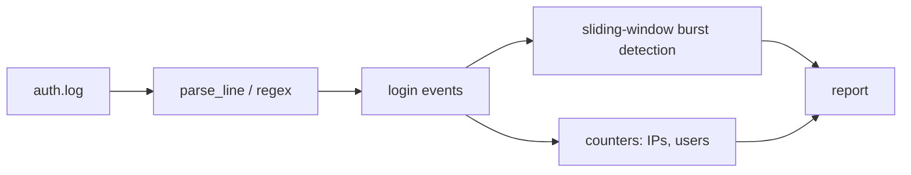

# log-analyzer

[](https://github.com/AJJudkins/log-analyzer/actions/workflows/ci.yml)

A small Python tool that parses SSH/auth-style syslog files, counts failed and accepted logins, and flags **failed-login bursts** (many failures from one IP in a short window), a common sign of brute-force attempts.

## Problem
Auth logs are noisy. Admins need a quick way to see who is failing to log in, from where, and whether it looks automated.

## How it works


## Setup
```bash
python3 -m venv .venv && source .venv/bin/activate
pip install pytest
pytest
```
No runtime dependencies (standard library only).

## Usage
```bash
python analyzer.py sample_data/auth.log                       # auto-detects format
python analyzer.py /var/log/auth.log --threshold 10 --window 120   # may need read permission (e.g. sudo/adm group)
python analyzer.py /var/log/nginx/access.log --format nginx   # 401/403 responses count as failures
zcat /var/log/auth.log.2.gz | python analyzer.py - --redact-ips
python analyzer.py auth.log --fail-on-burst --json            # exit 1 if a burst is found (CI / cron)
pip install . && log-analyzer auth.log                        # console script
```
Options: `--format {auto,syslog,nginx,apache}`, `--threshold`, `--window`, `--year`, `--redact-ips`, `--fail-on-burst`, `--json`. Use `-` for stdin; `.gz` files are read directly.

- **Formats:** classic syslog (`Oct 12 08:05:01 ...`) and rsyslog ISO-8601 timestamps for sshd `Failed ...`, `Invalid user ...`, `Accepted ...` lines; nginx/apache common and combined access logs (HTTP 401/403 = failed; 2xx with an authenticated user = accepted).
- **Streaming:** reads one line at a time and keeps only a small sliding window per IP, so large files do not need to fit in memory. Input is assumed to be in chronological order, as logs normally are.
- **Redaction:** `--redact-ips` replaces IPs in the output with `ip-xxxxxxxx` tags using a random per-run salt (consistent within a run, not reversible, different each run). It redacts the report only; it does not alter the log. Usernames are not redacted.
- **Read-only:** the tool never writes to or modifies logs.
- **Exit codes:** 0 ok, 1 burst found (with `--fail-on-burst`), 2 usage or read error.

## Sample output
```
=== Auth Log Report ===
Events parsed:   10
Failed logins:   8
Accepted logins: 2
Top failed IPs:   203.0.113.50 (6), 198.51.100.7 (2)
Top failed users: root (4), bob (2), admin (1)
Bursts (>= 5 failures in 60s):
  ALERT 203.0.113.50: 6 failures
```

## Notes
- `sample_data/auth.log` is fabricated, using reserved documentation IP ranges (RFC 5737). No real data.
- Only OpenSSH lines and nginx/apache access logs are understood; other lines are counted as unmatched.
- Authorized use: only analyze logs from systems you own or are permitted to review.

## What it demonstrates
Log parsing with regex, sliding-window detection logic, CLI design with argparse, and unit testing with pytest, with a security-operations flavor.

## Security and testing status

- **Safety:** read-only: reads log files, `.gz` files or stdin and prints a report; never writes to or modifies logs. `--redact-ips` masks IPs in the report with per-run salted tags (it does not alter the log, and usernames are not redacted). Analyze only logs you are allowed to review.
- **Tested:** syslog (classic and ISO timestamps), nginx/apache access-log parsing, gzip and stdin input, streaming memory bound, redaction and exit codes, all on small synthetic fixtures built to match documented formats.
- **Not tested:** real production `/var/log/auth.log` or web server logs (never run against any real log), very large multi-GB files, logs rotated mid-read, non-English locales, or custom log formats.
- See [SECURITY.md](SECURITY.md).

## License
MIT
