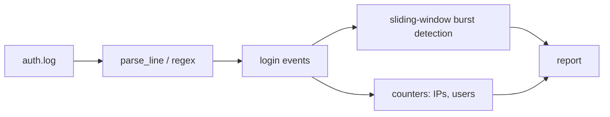

# log-analyzer

A small Python tool that parses SSH/auth-style syslog files, counts failed and accepted logins, and flags **failed-login bursts** (many failures from one IP in a short window), a common sign of brute-force attempts.

## Problem
Auth logs are noisy. Admins need a quick way to see who is failing to log in, from where, and whether it looks automated.

## How it works


## Setup
```bash
python3 -m venv .venv && source .venv/bin/activate
pip install pytest
pytest
```
No runtime dependencies (standard library only).

## Usage
```bash
python analyzer.py sample_data/auth.log
python analyzer.py sample_data/auth.log --threshold 3 --window 30 --json
```
Options: `--threshold` (failures to alert, default 5), `--window` (seconds, default 60), `--year` (syslog lines lack a year), `--json`.

## Sample output
```
=== Auth Log Report ===
Events parsed:   10
Failed logins:   8
Accepted logins: 2
Top failed IPs:   203.0.113.50 (6), 198.51.100.7 (2)
Top failed users: root (4), bob (2), admin (1)
Bursts (>= 5 failures in 60s):
  ALERT 203.0.113.50: 6 failures
```

## Notes
- `sample_data/auth.log` is fabricated, using reserved documentation IP ranges (RFC 5737). No real data.
- Only handles OpenSSH-style `Failed password` / `Accepted ...` lines. Other log formats are ignored.
- Authorized use: only analyze logs from systems you own or are permitted to review.

## What it demonstrates
Log parsing with regex, sliding-window detection logic, CLI design with argparse, and unit testing with pytest, with a security-operations flavor.

## License
MIT
